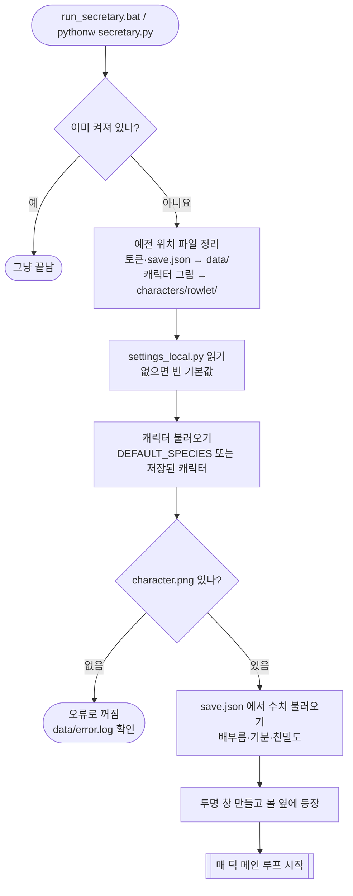
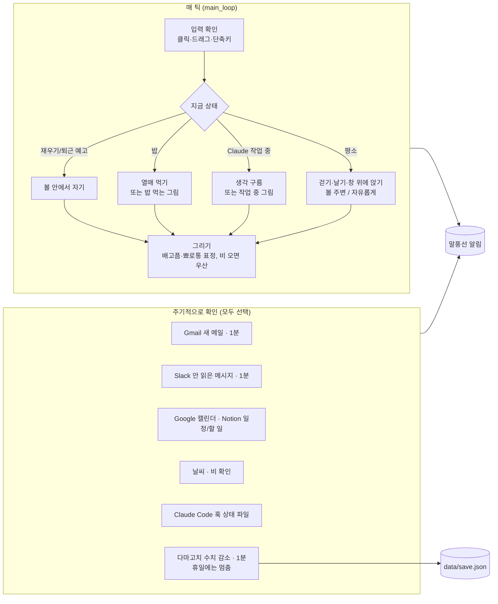
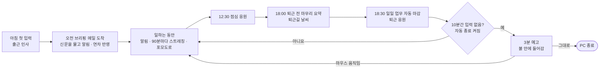

# my_secretary

Windows 바탕화면 위를 돌아다니는 마스코트 비서예요. 걷고, 날고, 자고, 배고파하면서 일정·할 일·메일·날씨를 말풍선으로 알려 줘요. 파이썬 `tkinter`만 쓰고, 외부 서비스 연결은 모두 선택이에요.

> 개인 프로젝트예요. 누구나 내려받아 쓸 수 있어요. 다만 캐릭터 그림은 저작권 때문에 이 저장소에 **들어 있지 않아서**, 실행하려면 그림 파일 한 장을 직접 넣어야 해요. [시작하기](#시작하기)부터 따라 하세요.

## 주요 기능

- **마스코트**: 화면 위를 걷거나 날고, 창 위에 앉고, 열매·공을 따라가요. 클릭하면 반응해요.
- **다마고치**: 배부름·기분·친밀도가 시간에 따라 줄고, 먹이를 주면 올라요. 친밀도 Lv.10마다 볼이 몬스터볼 → 슈퍼볼 → 하이퍼볼 → 마스터볼 → 프리미어볼로 바뀌어요. 재우기(포모도로 25분)를 누르면 볼 안에 들어가 자요. 쉬는 중에 혼자 잠들지는 않아요. 휴일(주말·공휴일·내 연차)에는 수치가 줄지 않아요.
- **일정·업무** (모두 선택)
  - Google 캘린더: 오늘 일정, 연차 읽기, 일정 넣기
  - Notion: 내 할 일, 팀 일정, 일일 업무 쓰기, 18:30 자동 마감
  - Gmail(IMAP): 새 메일 알림, 오전 브리핑 메일
  - Slack: 안 읽은 메시지 확인
- **날씨**: 퇴근길(18~19시) 날씨 안내, 지금 비가 오면 우산을 들고 있어요.
- **편의 기능**: 18:30 이후 자리를 비우면 PC 자동 종료(켜고 끄기 가능), 점심·퇴근 시간 응원 포즈, Claude Code 작업 상태 표시.
- **단축키**: `Ctrl+Alt+N` 할 일 빠른 추가, `Ctrl+Alt+K` 클로드에게 묻기, `Ctrl+Alt+H` 숨기기, `Ctrl+Alt+D` 일일 업무 창.
- **도감**: `characters/` 폴더에 그림과 설정을 넣으면 새 캐릭터를 키울 수 있어요. 캐릭터마다 밥 먹는 모습·Claude 작업 중 모습(여러 장이면 움직이는 그림)을 넣거나, 몬스터볼 없이 제자리에서 자게 할 수도 있어요. 방법은 [`characters/_양식/README.txt`](characters/_양식/README.txt).

## 동작 흐름

### 켜질 때



### 켜져 있는 동안



### 하루 흐름



## 실행 환경

- Windows 10/11, Python 3 (tkinter 포함. python.org 설치 프로그램에는 들어 있어요). Python 3.14에서 만들고 시험했어요. 다른 버전은 확인하지 않았어요.
- 외부 파이썬 패키지는 없어요(표준 라이브러리만 사용). `pip install`이 필요 없어요.

## 시작하기

1. **내려받기**: 둘 중 하나로 받아요.
   - 이 저장소 페이지 위쪽의 초록색 **Code** 버튼 → **Download ZIP**을 누르고, 받은 ZIP을 원하는 폴더에 풀어요.
   - 또는 Git이 있으면 아래처럼 받아요.
     ```
     git clone https://github.com/yoonheon051/my_secretary.git
     ```
2. **Python 설치**: [python.org](https://www.python.org/downloads/)에서 Python 3를 설치해요. 설치 화면에서 **Add python.exe to PATH**를 꼭 체크하세요.
3. **캐릭터 그림 넣기**: 배경이 투명한 PNG 한 장을 `character.png`라는 이름으로 `characters\rowlet` 폴더에 넣어요(폴더가 없으면 만들어요). 자세한 건 [캐릭터 그림](#캐릭터-그림).
   - **이 파일이 없으면 시작하자마자 오류로 꺼져요.** (직접 확인했어요.)
   - 이 한 장만 있어도 실행돼요. 다른 모습(자는 모습, 배고픈 모습 등)은 선택이에요.
4. **실행**: `run_secretary.bat`을 더블클릭해요. 또는 폴더에서 아래처럼 실행해요.
   ```
   pythonw secretary.py
   ```
5. 이미 켜져 있으면 또 켜지지 않아요.

> **처음 켜고 바로 확인하세요**: 18:30 이후 자리를 비우면 PC가 자동으로 꺼지는 기능이 **기본으로 켜져 있어요.** 원하지 않으면 마스코트를 우클릭해서 `설정·기타` 메뉴의 "18:30 이후 자리를 비우면 PC 자동 종료"를 꺼 주세요.

일정·메일·Slack 같은 외부 서비스 연결은 모두 선택이에요. 안 해도 마스코트와 다마고치는 쓸 수 있어요. 연결하려면 [내 설정과 비밀 값](#내-설정과-비밀-값)을 보세요.

## 캐릭터 그림

그림 파일은 `.gitignore`로 제외돼서 저장소에 없어요. **직접 만든 그림이나 쓸 권한이 있는 그림**을 `characters\rowlet` 폴더에 넣어요. (예전처럼 프로젝트 폴더 바로 아래에 넣어도, 켤 때 이 폴더로 옮겨져요.)

| 파일 | 설명 |
| --- | --- |
| `character.png` | **필수.** 평소 모습. 배경이 투명한 PNG, 왼쪽을 보는 그림 |
| `character_sleep.png`, `character_hungry.png`, `character_grumpy.png` | 자는 모습, 배고픈 모습, 뾰로통한 모습 (선택) |
| `character.json` | 눈·입 좌표 등 설정 (선택) |

- 파일 형식은 PNG예요(tkinter가 읽는 형식이에요). JPG는 안 돼요.
- 처음에는 아무 PNG 한 장으로 시험해 봐도 돼요. 투명 배경에 둥근 그림만 있어도 돌아가요(그렇게 시험했어요).
- 눈 깜빡임 같은 표정 효과는 `character.json`에 눈 위치를 적어야 그림 위에 덧그려져요.

그림 크기·좌표 지정 방법은 [`characters/_양식/README.txt`](characters/_양식/README.txt)의 설명을 따라요(새 캐릭터용 설명이지만 같은 방식이에요).

### 새 캐릭터 추가 (도감)

`characters/_양식` 폴더를 복사해서 영어 이름으로 바꾸고(`_`로 시작하면 도감이 건너뛰어요), `character.png`와 `species.json`을 채워요. 상태 카드의 이름을 누르면 도감이 열리고 "함께 키우기"로 바꿀 수 있어요. 수치는 캐릭터마다 따로 저장돼요.

`species.json`에서 고를 수 있는 것:

| 항목 | 설명 |
| --- | --- |
| `poses.hungry` / `sleep` / `grumpy` | 평소 그림 위에 눈·입을 덧그리거나, 따로 그린 그림을 써요 |
| `poses.eat` | 밥 먹는 모습. 있으면 열매 없이 그 자리에서 바로 먹어요 |
| `poses.busy` | Claude 작업 중 모습. 없으면 생각 구름이 떠요 |
| 폴더 + `ms` | `image`에 폴더 이름을 적으면 안의 PNG를 순서대로 넘겨 움직이는 그림이 돼요 |
| `ball` | `false`면 몬스터볼 없이 제자리에서 자요 |
| `balls` | 친밀도 레벨별 볼 이름·무늬·색 |

처음 함께할 캐릭터는 `settings_local.py`의 `DEFAULT_SPECIES`(캐릭터 폴더 이름)로 정해요. 비워 두면 나몰빼미예요.

**저작권 안내**: 포켓몬과 캐릭터 이름은 닌텐도·게임프리크·크리처스·포켓몬 컴퍼니의 것이에요. 이 프로젝트는 비공식 팬 프로젝트이고 이들과 관련이 없어요. 포켓몬 그림을 쓴다면 개인적으로만 쓰고 다시 배포하지 마세요.

## 내 설정과 비밀 값

개인 값은 저장소에 올라가지 않는 파일에만 둬요. `settings_local.py`를 뺀 나머지는 모두 `data` 폴더에 있어요(처음 켤 때 만들어져요).

- **`settings_local.py`**: `settings_local.example.py`를 복사해서 이름을 바꾸고 값을 채워요. Notion 이메일·데이터베이스 ID, 날씨 위치, 기본 캐릭터(`DEFAULT_SPECIES`)가 들어가요. 없으면 빈 기본값을 써서, Notion 기능은 꺼진 채 돌아가요.
- **토큰 파일(`*.dat`)**: 앱 화면(우클릭 메뉴의 연결 창)에서 입력하면 Windows 계정으로만 풀 수 있게 암호화(DPAPI)해서 저장해요. 다른 PC나 다른 Windows 계정에서는 읽을 수 없어요.
- **`client_secret.json`**: Google 캘린더용. Google Cloud Console에서 "데스크톱 앱" 클라이언트를 만들어 받은 파일을 `data` 폴더에 넣어요.
- **`save.json`**: 키운 기록(레벨, 친밀도 등). 자동으로 만들어져요.

위 파일들은 모두 `.gitignore`에 들어 있어요. **올리기 전에 `git status`로 한 번 더 확인하세요.**

## 폴더 구조

```
secretary.py            시작 파일 (파일 구성 안내가 맨 위에 있어요)
run_secretary.bat       Windows 실행 파일
claude_hook.py          Claude Code 작업 상태를 앱에 알리는 훅
settings_local.example.py  내 설정 예시
mascot/
  constants.py          설정 숫자·경로·말 모음 (동작을 바꾸려면 여기부터)
  species.py            포켓몬(캐릭터) 정의
  notion.py, google_calendar.py, mail.py, slack.py, weather.py   외부 서비스
  pet/                  마스코트 동작 (그리기, 걷기, 볼, 도감, 일일 업무 창 등)
characters/_양식/       새 캐릭터 추가 양식과 설명
characters/rowlet/      기본 캐릭터 그림 (직접 넣음, 저장소에 없음)
data/                   토큰·저장·휴일·오류 기록 (자동으로 생김, 저장소에 없음)
```

## 알아 둘 점

- Windows 전용이에요(투명 창, DPAPI 암호화, 자동 종료 등에 Windows 기능을 써요).
- 개인 업무 환경에 맞춰 만든 프로젝트라서 Notion 데이터베이스 항목 이름(예: 일정·일일업무 DB의 속성 이름)이 다르면 그대로는 동작하지 않을 수 있어요.
- 18:30 이후 자동 종료는 **켜 둔 상태가 기본값**이에요. 처음 켜면 우클릭 메뉴(`설정·기타`)에서 끌 수 있어요. 마우스·키보드 입력이 10분 없을 때만 동작하고, 3분 예고 뒤에 꺼져요. 그 사이 마우스를 움직이면 취소돼요.
- 처음 켜면 공휴일 정보를 받으려고 인터넷에 접속해서 `data/holidays.json`을 만들어요.
- Claude Code 작업 상태를 보려면 `~/.claude/settings.json`의 훅에서 `pythonw claude_hook.py <이벤트>`를 부르게 해요. 상태 파일은 OneDrive 동기화를 피하려고 `%LOCALAPPDATA%\my_secretary`에 저장돼요.
- 문제가 생기면 `data` 폴더의 `error.log`를 확인하세요.
